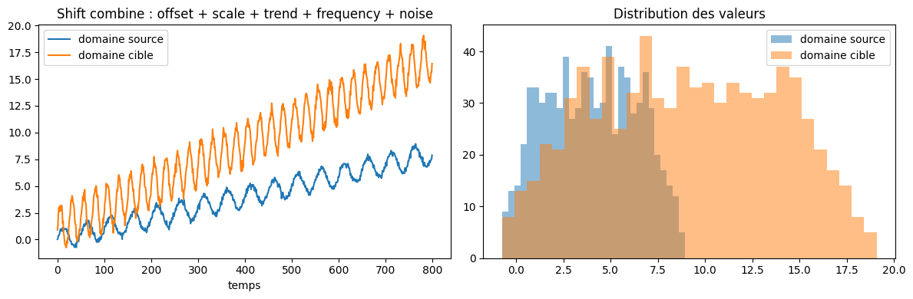
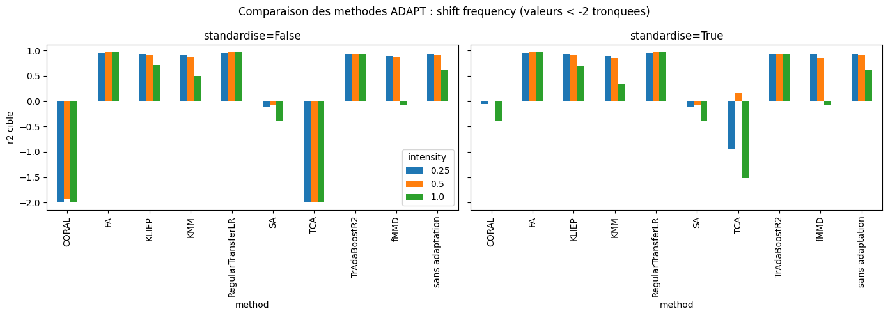
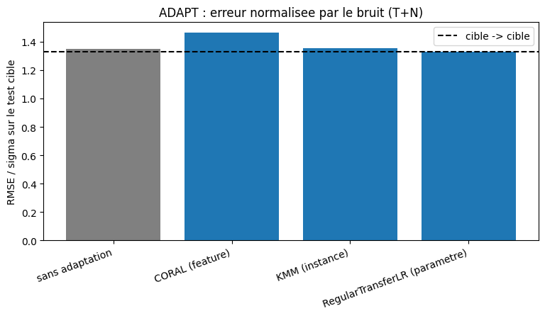
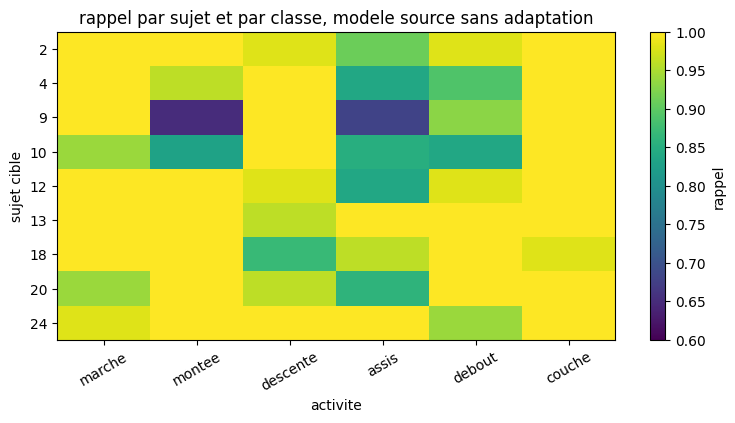

# Domain adaptation on time series

Code from a research internship at ENSIIE, July to September 2026.

Most domain adaptation methods were designed for independent samples. A time series is
not that: consecutive windows overlap, and the target value is taken from the trajectory
itself. I wanted to know what these methods actually do in that case, and whether the
usual vocabulary still describes what happens.

I built a generator that produces source and target series with a shift I control,
compared nine methods from the ADAPT library on it, ran the same comparison on two real
datasets, and then went back to the definitions to see which of them still hold.

## Repository layout

```
notebooks/
   ├── series_utils.py       generation of the synthetic series
   ├── adapt_utils.py        windowing, splits, ADAPT evaluation
   ├── generateur.ipynb      builds the 6 shifts
   ├── test_adapt.ipynb      compares the 9 methods
   ├── extraction_stl.ipynb  checks the seasonal decomposition
   ├── statsmodels.ipynb     ARIMA checks
   │
   ├── meteo/
   │   ├── prevision_meteo.ipynb       main notebook
   │   ├── forecast_statsmodels.ipynb  STL forecast and ARIMA
   │   └── test_meteo.ipynb            first look at the data
   │
   ├── har/
   │   ├── classification_har.ipynb                main notebook
   │   ├── classification_har_brut.ipynb           raw signals
   │   ├── classification_har_brut_features.ipynb  raw signals plus features
   │   └── test_har.ipynb                          first look at the data
   │
   ├── offset/      level shift
   ├── scale/       amplitude shift
   ├── trend/       slope shift
   ├── frequency/   period shift
   ├── noise/       noise shift
   └── combined/    the five shifts together
data/
   └── synthetic/   generated source-target pairs (.npz), one per shift and intensity
figures/            the figures shown below
rapport_stage.pdf   full report, in French
presentation.pdf    slides, in French
```

## Data

The synthetic pairs are in the repository, so `generateur.ipynb` and `test_adapt.ipynb`
run as they are. The notebooks read them at `../../data/synthetic`.

The two real datasets are too large to keep here. Download them and put them where the
notebooks expect:

- Human Activity Recognition Using Smartphones, from UCI, into `data/UCI HAR Dataset/`.
  https://archive.ics.uci.edu/dataset/240/human+activity+recognition+using+smartphones
- Historical Hourly Weather Data, from Kaggle, into `data/meteo/`. Only
  `temperature.csv` is used.
  https://www.kaggle.com/datasets/selfishgene/historical-hourly-weather-data

## Install

```
pip install numpy pandas scipy matplotlib scikit-learn statsmodels adapt
```

## 1. A generator with shifts I control

Each series is written as

```
z_t = g(t) + f(z_{t-1}, ..., z_{t-p}) + e_t
```

where `g` is the deterministic part, `f` the memory and `e_t` the noise. A domain is the
triple `(g, f, sigma)`, and a shift means changing one of the three. Six shifts, each at
three intensities: level, slope, amplitude, period, noise, and all of them together.



Because I know what I changed, I also know what the gap between the two conditional laws
should look like, which matters for section 5.

## 2. Nine methods on those shifts

Three families from ADAPT: feature based (CORAL, SA, TCA, fMMD), instance based (KMM,
KLIEP) and parameter based (RegularTransferLR), plus two supervised ones (FA,
TrAdaBoostR2). Each is compared against doing nothing, with and without standardisation.



The period shift is the only one that really hurts. Three methods out of nine improve on
doing nothing, and they are exactly the three that use labels from the target domain.
Three others fall below zero, which means they do worse than predicting the mean.

Those three winners see 80 percent of the target domain labelled, so this is not a
few-shot setting. The interesting part is that the six unsupervised methods fail even
though they get all the target inputs.

## 3. Forecasting hourly temperature

Five US cities. Four of them are the source, Miami is the target, and the task is to
predict the temperature 24 hours ahead from the past 24 hours. The daily and yearly
cycles are removed first, with a decomposition fitted on the training period only and
extended to the test period by averaging the four training years.

The error is reported as RMSE divided by the noise level of the domain, so that 1 is the
floor nobody can go below. The usual R-squared does not work here: its denominator is the
variance of the city being evaluated, which collapses once the cycles are removed.



Transferring the model without any correction gives 1.639, against 1.328 for a model
trained on Miami. Subtracting from each city its own training mean brings it down to
1.348, within 1.5 percent of the local model and with no label from the target. CORAL and
KMM, which work in the same setting, do worse.

The reason is in the model itself. Its coefficients sum to 0.88, not 1, so it keeps 12
percent of its prediction for the mean it learned during training. Miami is 11 degrees
warmer, and 12 percent of 11 degrees is 1.29. The measured bias is 1.37. The problem is
not that the model shrinks towards a mean, it is which mean it shrinks towards: after
recentring the coefficients sum to 0.74, so it shrinks more, and the bias falls to 0.18.

## 4. Classifying human activity

Thirty people wearing a smartphone at the waist, six activities, 561 features per 2.56
second window. Twenty-one subjects are the source, nine are the target, and no person
appears on both sides of a split, since consecutive windows overlap by half.



The overall accuracy on the target is 0.958, which hides the real picture. Stair climbing
is where people differ most, and a model that has seen six people does not cover the
seventh. With a source reduced to six subjects, one subject gets half of his stair
descents wrong while his overall score stays at 0.887.

On that subject RegularTransferLC raises stair descent from 0.491 to 0.862, while a model
trained on the eight other target subjects drops to 0.255 even though it has more data.
Most of that gain is simply the number of different people the model has seen: with all
21 source subjects and no target data at all, the same subject already reaches 0.870.

## 5. Writing shifts for time series

The three classical forms, covariate shift, concept shift and label shift, all start from
pairs `(X_i, y_i)` drawn independently. Neither setting satisfies that. In forecasting two
consecutive windows share 23 values out of 24, in classification 64 measurements out of
128.

There is a second problem, specific to forecasting. In classification the joint law splits
into two mechanisms, `p(x, y) = p(x) p(y | x)`. You can freeze the second and move the
first, and that is what covariate shift means. A series splits differently:

```
P(z_1, ..., z_n) = P(z_1) * prod_t P(z_{t+1} | z_{1:t})
```

Here the conditionals are the whole model. Freeze all of them and the entire law is frozen,
initial condition aside. There is nothing left to move, so a covariate shift cannot even be
written down.

So I started from the generator instead. For the four shifts that only touch `g`, writing
`delta(t) = g_target(t) - g_source(t)` gives

```
P_target(y | X = x) = P_source(y - delta(t) | X = x)
```

and the shape of `delta` says what a model can do about it. A constant goes into the
intercept and costs nothing. A difference of two sines with different periods is a beat,
and nothing absorbs that, which is why the period shift is the one that hurts.

| what changes | shift | E[y \| x] | best predictor |
| --- | --- | --- | --- |
| sigma | noise | unchanged | unchanged |
| f | memory | changes | changes |
| g | level, slope, amplitude, period | translated by delta(t) | depends on delta |

All six shifts change the conditional law. In forecasting there is no pure covariate shift:
they are all concept shifts.

Both real datasets fit in this table. The weather case is a `g` shift with a constant delta
of 11 degrees, which is why a translation recovers almost everything. The activity case
falls outside it: the window is the observation, the label is written down by an operator
rather than taken from the signal, and the relation between window and activity does not
change from one person to the next, 0.886 against 0.881. That one is a covariate shift in
the classical sense.

## Report and slides

`rapport_stage.pdf` and `presentation.pdf`, both in French.
